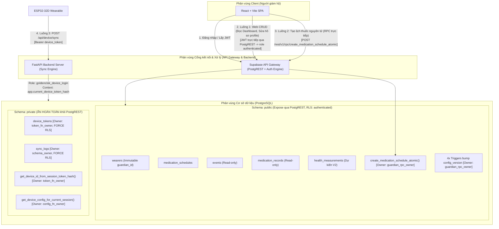

# BÁO CÁO PHÂN TÍCH KIẾN TRÚC BẢO MẬT LAI (HYBRID) & RANH GIỚI TIN CẬY DỮ LIỆU (PHASE 1.7.2 — BẢN HỢP NHẤT TOÀN DIỆN CUỐI CÙNG)
## DỰ ÁN: GOLDENCLOK — NỀN TẢNG FULL-STACK WEB CHO THIẾT BỊ ĐEO CHĂM SÓC NGƯỜI CAO TUỔI

> [!IMPORTANT]
> **QUYẾT ĐỊNH KIẾN TRÚC ĐÃ ĐƯỢC PHÊ DUYỆT (ARCHITECTURAL DECISIONS FINALIZED)**
> Dựa trên thẩm quyền được **Project Owner** giao phó trực tiếp, Kiến trúc sư chính (**ChatGPT — Lead Architect**) đã chính thức ban hành các quyết định định hướng kiến trúc mục tiêu:
> 1. **Phương án D — Kiến trúc Lai (Hybrid Architecture):** ĐÃ ĐƯỢC PHÊ DUYỆT LÀ KIẾN TRÚC MỤC TIÊU (`APPROVED AS TARGET ARCHITECTURE`). Không yêu cầu thêm vòng phê duyệt kiến trúc thứ hai.
> 2. **Đường đọc Cấu hình Thiết bị (Device Config Read Path):** Chốt thực hiện theo **Hướng B — Dedicated `SECURITY DEFINER` Function** (`private.get_device_config_for_current_session()`).
> 3. **Mô hình Bảo mật RPC Tạo lịch thuốc:** Chốt thực hiện theo **`SECURITY DEFINER`**, bắt buộc tự kiểm tra `auth.uid()` và quyền sở hữu thực tế trong thân hàm.
> 4. **Luồng gọi RPC của Người giám hộ:** Chốt gọi trực tiếp từ **React SPA qua Supabase PostgREST bằng JWT đã xác thực**. Tuyệt đối không chuyển tiếp JWT qua FastAPI cho thao tác tạo lịch thuốc.
> 5. **Luồng Đồng bộ Vi điều khiển:** Tiếp tục đi qua **FastAPI Endpoint `POST /api/device/sync`** sử dụng runtime role riêng biệt (`goldenclok_device_login` $\to$ `goldenclok_device_role`). Role này không có quyền `SELECT` trực tiếp trên các bảng cấu hình `public`.
> 6. **Supabase Realtime:** Tiếp tục hoãn lại (**`DEFERRED`**) khỏi phạm vi phiên bản V1.
>
> **Phân định rõ ràng giữa Quyết định Kiến trúc và Hiện trạng Kỹ thuật:**
> - *Định hướng Kiến trúc (Architectural Direction):* Đã được phê duyệt chính thức.
> - *Triển khai CSDL thực tế (Database Implementation):* Chưa viết migration, chưa tạo bảng/role, tiếp tục gắn nhãn **`[UNTESTED]`**.
> - *Chi tiết Hợp đồng Firmware cần thống nhất liên đội:* Tiếp tục duy trì trạng thái **`[OPEN]`**.

---

## 1. TỔNG QUAN PHÊ DUYỆT KIẾN TRÚC & NGUYÊN TẮC BẢO MẬT CỐT LÕI

Bản tài liệu này là căn cứ kỹ thuật chuẩn mực duy nhất cho hệ thống CSDL và ranh giới bảo mật của dự án WebGoldenClock:

1. **Bản chất của RLS trước nguy cơ Backend RCE `[FACT VERIFIED]`:**  
   Row Level Security (RLS) khi triển khai qua một Backend tập trung (FastAPI kết nối qua connection pool) **không phải là cơ chế ngăn chặn Remote Code Execution (RCE)**. Database không tự kiểm tra chữ ký cryptographic của JWT khi nhận câu lệnh `set_config()`. Kẻ tấn công nếu chiếm được quyền thực thi mã trên Backend hoàn toàn có thể ép tiến trình phát lệnh gán bất kỳ tham số ngữ cảnh nào. Do đó, RLS ở tầng Database đóng vai trò là **Hàng phòng thủ chiều sâu (Defense-in-Depth)** để giảm thiểu lỗi logic truy vấn (như thiếu mệnh đề WHERE, lỗi điều kiện lọc, rò rỉ IDOR), và hỗ trợ **giới hạn bán kính thiệt hại (blast radius limitation)** thông qua phân quyền role tối thiểu, chứ không thể thay thế việc bảo vệ tầng ứng dụng và không mang lại khả năng miễn nhiễm RCE 100%.
2. **Vai trò của tài khoản `postgres` trên Supabase Cloud `[FACT VERIFIED]`:**  
   Trên Supabase Cloud, tài khoản `postgres` **không phải là Linux/OS Superuser**. Nó là tài khoản quản trị dự án (Project Admin Role) được cấp các cờ đặc quyền `CREATEROLE`, `CREATEDB`, `REPLICATION` và `BYPASSRLS`. Tài khoản Superuser thực thụ thuộc về hạ tầng vận hành của nhà cung cấp (`supabase_admin`).
3. **Quyền hạn của Migration Role `[FACT VERIFIED]`:**  
   Migration Role chạy công cụ di chuyển dữ liệu (Alembic) chỉ cần quyền DDL (`CREATE`, `ALTER`, `DROP`, `GRANT`), **hoàn toàn không cần và không được cấp cờ `BYPASSRLS`**. Việc cấp `BYPASSRLS` cho migration role là vi phạm nguyên tắc đặc quyền tối thiểu (Least Privilege).
4. **Quy tắc bất biến về Schema Ownership trên Supabase `[FACT VERIFIED]`:**  
   Trên Supabase, **tuyệt đối không chạy lệnh `ALTER SCHEMA public OWNER TO ...`**. Schema `public` được hệ thống Supabase quản lý để cài đặt các extensions cốt lõi (`uuid-ossp`, `pgcrypto`) và cấp quyền cho API Gateway (PostgREST). Thay vào đó, schema `public` giữ nguyên ownership của Supabase, Migration Role được cấp `CREATE ON SCHEMA public`, và schema ứng dụng nội bộ (`private`) do custom schema owner sở hữu.
5. **Cú pháp an toàn cho `SECURITY DEFINER` `[FACT VERIFIED]`:**  
   Hàm chạy với quyền của chủ sở hữu (`SECURITY DEFINER`) bắt buộc phải thiết lập `SET search_path = ''` và sử dụng tên bảng tường minh (fully qualified schema names: `private.table_name`, `pg_catalog.text`) để triệt tiêu hoàn toàn nguy cơ chiếm đoạt đường dẫn tìm kiếm (Search-Path Hijacking).
6. **Giới hạn của Supabase Realtime Postgres Changes với sự kiện DELETE `[FACT VERIFIED]`:**  
   Mặc dù `REPLICA IDENTITY FULL` cho phép WAL chứa toàn bộ dữ liệu dòng cũ, **Supabase Realtime Postgres Changes hiện tại không thực thi RLS policies cho các sự kiện DELETE**. Do đó, không thể dựa vào Realtime Postgres Changes để truyền tải sự kiện xóa an toàn giữa các tenant.
7. **Bất biến về Quyền sở hữu Hồ sơ Người thân trong V1 (`guardian_id` Immutable) `[APPROVED]`:**  
   Trong phiên bản V1, `guardian_id` và `id` của hồ sơ `public.wearers` là bất biến sau khi được tạo. Vai trò `authenticated` bị thu hồi quyền `UPDATE` cấp bảng trên `wearers`, chỉ được cấp `UPDATE` mức cột trên các trường thông tin hồ sơ được phép sửa (`name`, `date_of_birth`, `notes`), và bị cấm tuyệt đối thao tác `DELETE`. Quy trình chuyển nhượng người thân hoặc ghép nối lại duy trì trạng thái **`[OPEN]`**.
8. **Rủi ro của cơ chế Xóa tài khoản đối với Thiết bị phần cứng `[OPEN]`:**  
   Việc thiết lập xóa tự động không kiểm soát từ tài khoản người giám hộ xuống hồ sơ thiết bị tiềm ẩn nguy cơ làm "mồ côi" (orphan/strand) thiết bị phần cứng đang đeo trên tay người cao tuổi ở trạng thái `paired`, phá vỡ Hợp đồng Firmware và gây rủi ro an toàn vận hành.

---

## 2. MA TRẬN PHÂN QUYỀN CƠ SỞ DỮ LIỆU & TÁCH BIỆT CHỦ SỞ HỮU HÀM (CONSOLIDATED PRIVILEGE MATRIX) `[PROPOSED]`

*(Căn cứ: PostgreSQL Documentation — Chapter 21. User Names and Roles, Chapter 5.7. Privileges; Supabase Documentation — Database Privileges)*.

### 2.1. Hợp nhất Vai trò Chủ sở hữu Hàm (Function Owners) chuyên biệt
Để bảo đảm nguyên tắc Đặc quyền Tối thiểu (Least Privilege), **hệ thống loại bỏ hoàn toàn việc dùng chung owner `goldenclok_schema_owner` cho mọi hàm**. Thiết lập mô hình 4 role `NOLOGIN` phân quyền độc lập:
- **`goldenclok_schema_owner` (`NOLOGIN`):** Sở hữu schema `private` và bảng nhật ký đồng bộ `private.sync_logs`. Không sở hữu hàm resolver, hàm config reader hay hàm RPC.
- **`goldenclok_token_fn_owner` (`NOLOGIN`):** Sở hữu bảng `private.device_tokens` và hàm resolver `private.get_device_id_from_session_token_hash()`. Được cấp `USAGE, CREATE ON SCHEMA private`. Bảng `private.device_tokens` bật `FORCE ROW LEVEL SECURITY` và có chính sách RLS `SELECT` riêng cho chính role này dựa trên GUC `app.current_device_token_hash`. Tuyệt đối không có quyền trên dữ liệu Người giám hộ trong `public`.
- **`goldenclok_config_fn_owner` (`NOLOGIN`):** Sở hữu hàm đọc cấu hình thiết bị `private.get_device_config_for_current_session()`. Được cấp `USAGE, CREATE ON SCHEMA private`, `USAGE ON SCHEMA public`, và `EXECUTE` trên resolver. Tuyệt đối không có quyền `SELECT` trên `private.device_tokens`.
- **`goldenclok_guardian_rpc_owner` (`NOLOGIN`):** Sở hữu hàm RPC `public.create_medication_schedule_atomic()` và 4 trigger functions cập nhật `config_version`. Được cấp `USAGE, CREATE ON SCHEMA public`, `USAGE` trên schema `auth`, và `EXECUTE` trên `auth.uid()`. Về quyền trên bảng:
  - `public.devices`: Cấp `SELECT (id, config_version, wearer_id), UPDATE (config_version, updated_at)`.
  - `public.wearers`: Cấp `SELECT (id, guardian_id, name)`. **TUYỆT ĐỐI KHÔNG CẤP QUYỀN UPDATE HOẶC DELETE TRÊN `public.wearers`!**
  - `public.guardians`: Cấp `SELECT (id, emergency_phone)` (phục vụ trigger cập nhật `config_version`).
  - `public.medication_schedules`: Cấp `SELECT, INSERT` (**KHÔNG CẤP UPDATE, DELETE**).
  - Schema `private`: Tuyệt đối không có quyền truy cập schema `private` hay bảng `private.device_tokens`.

*Quy tắc bất biến về RLS:* **Không có bất kỳ role nào trong 4 role trên được cấp cờ `BYPASSRLS`**.

### 2.2. Ma trận Phân quyền CSDL Toàn diện Nhất quán

| Vai trò CSDL (Role) | Bản chất Role & Thuộc tính | Quyền USAGE & CREATE trên Schema | Quyền Thao tác trên Bảng (Table Privileges) | Quyền trên Sequence / Function | Chính sách RLS Áp dụng | Trạng thái Kiểm nghiệm |
| :--- | :--- | :--- | :--- | :--- | :--- | :---: |
| **`anon`** | PostgREST Unauthenticated Role (`NOLOGIN`) | `public`: Cấp `USAGE`.<br>`private`: **KHÔNG CẤP**. | **REVOKE ALL** trên mọi bảng nghiệp vụ (`guardians`, `wearers`, `devices`, `medication_schedules`, `medication_records`, `events`, `device_tokens`, `sync_logs`). | **REVOKE ALL** trên mọi sequences và functions nghiệp vụ. | Bị chặn từ tầng Table Grants. (PostgREST trả về HTTP 401 hoặc 404 tùy cấu hình Gateway). | `[PROPOSED]`<br>`[UNTESTED]` |
| **`authenticated`** | PostgREST Authenticated Role (`NOLOGIN`) | `public`: Cấp `USAGE`.<br>`private`: **KHÔNG CẤP** (ẩn hoàn toàn khỏi PostgREST). | `guardians`: `SELECT, UPDATE`<br>`wearers`: `SELECT, INSERT, UPDATE(name, date_of_birth, notes)` *(V1 KHÔNG CẤP UPDATE trên id, guardian_id; KHÔNG CẤP DELETE)*<br>`devices`: `SELECT`<br>`medication_schedules`: `SELECT`<br>`medication_records`: `SELECT`<br>`events`: `SELECT, UPDATE(acknowledged_at)`<br>`health_measurements`: `SELECT` (dự kiến V2)<br>`private.device_tokens`: **KHÔNG CẤP**<br>`private.sync_logs`: **KHÔNG CẤP** | `public.create_medication_schedule_atomic`: `EXECUTE`<br>`private.get_device_id_from_session_token_hash`: **REVOKE ALL**<br>`private.get_device_config_for_current_session`: **REVOKE ALL**<br>Sequences trong `public` (nếu dùng): `USAGE` | RLS bắt buộc `TO authenticated` với điều kiện: `guardian_id = (SELECT auth.uid())` hoặc `id = (SELECT auth.uid())`. | `[PROPOSED]`<br>`[UNTESTED]` |
| **`goldenclok_device_login`** | Runtime Login Role cho Ingestion Pool (`LOGIN`, `NOINHERIT`) | `CONNECT` trên Database.<br>Không cấp trực tiếp USAGE trên schemas. | **KHÔNG CẤP TRỰC TIẾP** bất kỳ quyền bảng nào. | **KHÔNG CẤP TRỰC TIẾP** quyền sequence hay function. | Không thao tác dữ liệu dưới danh tính này. Chỉ dùng để mở kết nối TCP và `SET LOCAL ROLE goldenclok_device_role;`. | `[PROPOSED]`<br>`[UNTESTED]` |
| **`goldenclok_device_role`** | Device Ingestion Privilege Role (`NOLOGIN`, `NOINHERIT`) | `public`: Cấp `USAGE`.<br>`private`: Cấp `USAGE`. | `public.medication_records`: `INSERT`<br>`public.events`: `INSERT`<br>`private.sync_logs`: `INSERT`<br>`public.health_measurements`: `INSERT` (dự kiến V2)<br>`private.device_tokens`: **TUYỆT ĐỐI KHÔNG CẤP QUYỀN (KHÔNG SELECT, INSERT, UPDATE, DELETE)**<br>Các bảng khác (`guardians`, `wearers`, `devices`, `medication_schedules`): **KHÔNG CẤP QUYỀN TRỰC TIẾP** | `private.get_device_id_from_session_token_hash`: `EXECUTE`<br>`private.get_device_config_for_current_session`: `EXECUTE`<br>Sequences: **KHÔNG CẤP** (các bảng dùng UUID `gen_random_uuid()`) | RLS `FOR INSERT WITH CHECK`: `device_id = private.get_device_id_from_session_token_hash() AND private.get_device_id_from_session_token_hash() IS NOT NULL` trên `medication_records`, `events`, `sync_logs`. | `[PROPOSED]`<br>`[UNTESTED]` |
| **`goldenclok_token_fn_owner`** | NOLOGIN Owner của Token Helper & Tokens Table | `private`: `USAGE, CREATE`.<br>`public`: **KHÔNG CẤP**. | Table Owner của `private.device_tokens`. Bật `FORCE ROW LEVEL SECURITY`.<br>Các bảng `public`: **KHÔNG CẤP**. | Owner của `private.get_device_id_from_session_token_hash()`. | **KHÔNG CÓ `BYPASSRLS`**. Chịu sự kiểm soát của RLS policy `token_owner_select_device_tokens` dựa trên `app.current_device_token_hash`. | `[PROPOSED]`<br>`[UNTESTED]` |
| **`goldenclok_config_fn_owner`** | NOLOGIN Owner của Device Config Reader | `private`: `USAGE, CREATE`.<br>`public`: `USAGE`. | `SELECT` mức cột trên: `devices(id, config_version, hr_high, hr_low, wearer_id)`, `wearers(id, name, guardian_id)`, `guardians(id, emergency_phone)`, `medication_schedules(id, schedule_id, device_id, name, time, days, start_date, end_date)`.<br>`private.device_tokens`: **KHÔNG CẤP**. | `private.get_device_id_from_session_token_hash()`: `EXECUTE`.<br>Owner của `private.get_device_config_for_current_session()`. | **KHÔNG CÓ `BYPASSRLS`**. Chịu sự kiểm soát của RLS policies trên các bảng `public` lọc theo `device_id`. | `[PROPOSED]`<br>`[UNTESTED]` |
| **`goldenclok_guardian_rpc_owner`** | NOLOGIN Owner của Guardian Schedule RPC & Triggers | `public`: `USAGE, CREATE`.<br>`auth`: `USAGE`.<br>`private`: **KHÔNG CẤP**. | `devices`: `SELECT (id, config_version, wearer_id), UPDATE (config_version, updated_at)`<br>`wearers`: `SELECT (id, guardian_id, name)` *(KHÔNG CẤP UPDATE, DELETE)*<br>`guardians`: `SELECT (id, emergency_phone)`<br>`medication_schedules`: `SELECT, INSERT` *(KHÔNG CẤP UPDATE, DELETE)*<br>`private.device_tokens`: **KHÔNG CẤP**. | `auth.uid()`: `EXECUTE`.<br>Owner của `public.create_medication_schedule_atomic()` và 4 trigger functions cập nhật `config_version`. | **KHÔNG CÓ `BYPASSRLS`**. Chịu sự kiểm soát của RLS policies tường minh trên các bảng `public` lọc theo `auth.uid()`. | `[PROPOSED]`<br>`[UNTESTED]` |
| **`goldenclok_schema_owner`** | NOLOGIN Owner của Private Schema & Sync Logs | `private`: `USAGE, CREATE`.<br>`public`: **KHÔNG CẤP**. | Table Owner của `private.sync_logs`. Bật `FORCE ROW LEVEL SECURITY`.<br>`private.device_tokens`: **KHÔNG CẤP** (thuộc token_fn_owner). | Sequences trong `private` (nếu dùng): `USAGE`. | **KHÔNG CÓ `BYPASSRLS`**. | `[PROPOSED]`<br>`[UNTESTED]` |
| **`goldenclok_migration_user`** | DDL Runner Role cho CI/CD / Alembic (`LOGIN`, `NOINHERIT`) | `public`: `USAGE, CREATE`.<br>`private`: Thông qua membership các owner roles. | Quyền DDL tạo/sửa bảng trong `public`. Là member của các owner roles để `SET ROLE` khi triển khai các objects chuyên biệt. | Quyền DDL tạo/sửa functions, triggers, sequences, policies. | **KHÔNG CÓ CỜ `BYPASSRLS`** (DDL không bị RLS kiểm tra). | `[PROPOSED]`<br>`[UNTESTED]` |

---

## 3. THIẾT KẾ BẢNG TOKEN & BỘ GIẢI MÃ TOKEN (TOKEN RESOLVER & FORCE RLS) `[PROPOSED]`

*(Căn cứ: PostgreSQL Documentation — Chapter 5.8. Row Security Policies; Chapter 9. System Administration Functions)*.

### 3.1. Ràng buộc Kỹ thuật của `FORCE ROW LEVEL SECURITY` và Table Owner
Trong PostgreSQL:
- **Hành vi mặc định:** Table Owner mặc định sẽ bỏ qua (bypass) RLS trên chính bảng do mình sở hữu, ngay cả khi không có cờ `BYPASSRLS` cấp cluster.
- **Khi kích hoạt `FORCE ROW LEVEL SECURITY`:** Khi bảng được bật `FORCE ROW LEVEL SECURITY`, ngay cả **Table Owner cũng bị RLS kiểm tra nghiêm ngặt**.
- **Hệ quả cốt tử:** Mặc định của RLS là từ chối tất cả (`deny-all`). Nếu bảng `private.device_tokens` có `FORCE ROW LEVEL SECURITY` nhưng không định nghĩa bất kỳ chính sách `SELECT` nào cho `goldenclok_token_fn_owner`, hàm `private.get_device_id_from_session_token_hash()` khi chạy dưới quyền `goldenclok_token_fn_owner` **sẽ bị PostgreSQL từ chối truy cập (trả về 0 dòng)**!
- **Giải pháp bắt buộc:** Phải tạo chính sách RLS `SELECT` tường minh cho `goldenclok_token_fn_owner` ràng buộc với biến phiên `app.current_device_token_hash`.

### 3.2. Cấu trúc Bảng `private.device_tokens` và Chính sách RLS
Đối chiếu mô hình thực thể Phase 1.5, trường `token_hash` là chuỗi văn bản (`text`) biểu diễn mã băm SHA-256 (độ dài 64 ký tự hex), không phải kiểu nhị phân `bytea`.

```sql
-- DDL tạo bảng lưu trữ token thiết bị trong schema private:
CREATE TABLE private.device_tokens (
    id uuid PRIMARY KEY DEFAULT gen_random_uuid(),
    device_id uuid NOT NULL REFERENCES public.devices(id) ON DELETE CASCADE,
    token_hash text NOT NULL UNIQUE,
    created_at timestamptz NOT NULL DEFAULT pg_catalog.clock_timestamp(),
    revoked_at timestamptz
);

ALTER TABLE private.device_tokens OWNER TO goldenclok_token_fn_owner;
ALTER TABLE private.device_tokens ENABLE ROW LEVEL SECURITY;
ALTER TABLE private.device_tokens FORCE ROW LEVEL SECURITY;

-- Chính sách RLS bắt buộc cho chính Table Owner (giải quyết triệt để rào cản FORCE RLS):
CREATE POLICY token_owner_select_device_tokens ON private.device_tokens
FOR SELECT TO goldenclok_token_fn_owner
USING (
    token_hash = pg_catalog.current_setting('app.current_device_token_hash', true)
    AND revoked_at IS NULL
);

-- Bảo đảm không có role nào khác được SELECT trên bảng nhạy cảm này:
REVOKE ALL ON TABLE private.device_tokens FROM PUBLIC, anon, authenticated, goldenclok_device_role;
```

### 3.3. Hàm Giải mã Danh tính Thiết bị `private.get_device_id_from_session_token_hash()`
```sql
CREATE OR REPLACE FUNCTION private.get_device_id_from_session_token_hash()
RETURNS uuid
LANGUAGE plpgsql
STABLE
SECURITY DEFINER
SET search_path = ''
AS $$
DECLARE
    v_token_hash text;
    v_device_id uuid;
BEGIN
    -- 1. Lấy mã băm token từ biến cục bộ transaction do FastAPI nạp:
    v_token_hash := pg_catalog.current_setting('app.current_device_token_hash', true);
    IF v_token_hash IS NULL OR v_token_hash = '' THEN
        RETURN NULL;
    END IF;

    -- 2. Truy vấn device_id (chịu sự kiểm soát của policy token_owner_select_device_tokens):
    SELECT dt.device_id INTO v_device_id
    FROM private.device_tokens dt
    WHERE dt.token_hash = v_token_hash
      AND dt.revoked_at IS NULL;

    RETURN v_device_id;
END;
$$;

ALTER FUNCTION private.get_device_id_from_session_token_hash() OWNER TO goldenclok_token_fn_owner;
REVOKE ALL ON FUNCTION private.get_device_id_from_session_token_hash() FROM PUBLIC, anon, authenticated;
GRANT EXECUTE ON FUNCTION private.get_device_id_from_session_token_hash() TO goldenclok_device_role, goldenclok_config_fn_owner;
```

### 3.4. Ranh giới Tin cậy và Giới hạn Kỹ thuật (Trust Boundary Limitation)
- Biến GUC `app.current_device_token_hash` được tiến trình FastAPI gán vào transaction session sau khi đã băm token thô từ Bearer Header HTTP (`hashlib.sha256(token.encode()).hexdigest()`).
- Database không có kênh kiểm tra chữ ký độc lập với FastAPI cho token này; Database tin cậy giá trị do kết nối được xác thực bằng `goldenclok_device_login` cung cấp.
- Nếu tiến trình FastAPI bị chiếm quyền thực thi mã từ xa (RCE), kẻ tấn công sở hữu database credentials có thể phát lệnh `set_config('app.current_device_token_hash', ...)` với bất kỳ hash nào quan sát được.
- Vì vậy, cơ chế trên là **Hàng phòng thủ chiều sâu (Defense-in-Depth)** chống rò rỉ IDOR và lỗi logic mã nguồn trong luồng vận hành bình thường, đồng thời cô lập bảng `device_tokens` khỏi các role khác. Đây không phải cơ chế miễn nhiễm RCE tuyệt đối.

---

## 4. ĐƯỜNG ĐỌC CẤU HÌNH THIẾT BỊ (DEVICE CONFIG READ PATH) & BẢO VỆ GUARDIAN_PHONE `[APPROVED / UNTESTED]`

Lead Architect đã phê duyệt chính thức **Hướng B — Dedicated `SECURITY DEFINER` Function**.

> [!WARNING]
> **CẢNH BÁO KIẾN TRÚC VỀ SỐ ĐIỆN THOẠI KHẨN CẤP (FIX-09):**
> 1. **Bất biến Hệ thống (System Invariant):** Vi điều khiển chỉ được phép nhận số điện thoại khẩn cấp đã được xác minh qua OTP (`OTP-verified`).
> 2. **Hiện trạng Schema:** Bảng lưu mã OTP và trường cờ trạng thái xác minh điện thoại khẩn cấp hiện tại **chưa được Project Owner chốt và chưa có DDL kiểm nghiệm (`[OPEN / UNTESTED]`)**.
> 3. **Hai Phương án Triển khai:**
>    - *Phương án A (Workflow Invariant):* Ứng dụng Web chỉ ghi đè vào trường `guardians.emergency_phone` sau khi quy trình OTP thành công 100%. Đây là một invariant bắt buộc của workflow ứng dụng.
>    - *Phương án B (Schema Invariant):* Bảng `guardians` bổ sung cờ trạng thái (ví dụ `emergency_phone_verified boolean`), và hàm đọc cấu hình chỉ đọc trường này khi cờ là `true`.
> 4. **Trạng thái Đoạn mã SQL:** Hàm đọc cấu hình dưới đây được gắn nhãn **`[OPEN / UNTESTED — CHƯA ĐỦ ĐIỀU KIỆN TRIỂN KHAI PRODUCTION]`** vì nó giả định `guardians.emergency_phone` đã được bảo vệ bởi workflow. Tuyệt đối không tự ý giả định firmware chấp nhận `null` hay chuỗi rỗng `""` nếu Hợp đồng Firmware chưa quy định rõ (`[OPEN]`).
> 5. **Tác động Config Version:** Khi số điện thoại khẩn cấp chuyển từ trạng thái chưa xác minh sang đã xác minh (hoặc thay đổi giá trị gửi xuống firmware), sự kiện này bắt buộc phải làm tăng `config_version`. Chừng nào schema xác minh chưa hoàn tất, invariant này chưa được coi là hoàn thiện.

```sql
CREATE OR REPLACE FUNCTION private.get_device_config_for_current_session()
RETURNS jsonb
LANGUAGE plpgsql
STABLE
SECURITY DEFINER
SET search_path = ''
AS $$
DECLARE
    v_device_id uuid;
    v_config jsonb;
BEGIN
    -- 1. Lấy device_id được ràng buộc từ token hash của session (chạy qua resolver của token_fn_owner):
    v_device_id := private.get_device_id_from_session_token_hash();
    IF v_device_id IS NULL THEN
        RETURN NULL;
    END IF;

    -- 2. Truy vấn dữ liệu cấu hình đã được RLS policies của config_fn_owner lọc:
    -- (Lưu ý: g.emergency_phone bắt buộc phải được bảo vệ bởi OTP workflow invariant)
    SELECT pg_catalog.jsonb_build_object(
        'version', d.config_version,
        'wearer_name', w.name,
        'guardian_phone', g.emergency_phone,
        'hr_high', d.hr_high,
        'hr_low', d.hr_low,
        'schedule', COALESCE((
            SELECT pg_catalog.jsonb_agg(pg_catalog.jsonb_build_object(
                'id', s.schedule_id,
                'name', s.name,
                'time', s.time,
                'days', s.days,
                'start_date', s.start_date,
                'end_date', s.end_date
            ))
            FROM public.medication_schedules s
            WHERE s.device_id = v_device_id
        ), '[]'::jsonb)
    ) INTO v_config
    FROM public.devices d
    JOIN public.wearers w ON w.id = d.wearer_id
    JOIN public.guardians g ON g.id = w.guardian_id
    WHERE d.id = v_device_id;

    RETURN v_config;
END;
$$;

ALTER FUNCTION private.get_device_config_for_current_session() OWNER TO goldenclok_config_fn_owner;
REVOKE ALL ON FUNCTION private.get_device_config_for_current_session() FROM PUBLIC, anon, authenticated;
GRANT EXECUTE ON FUNCTION private.get_device_config_for_current_session() TO goldenclok_device_role;
```

### 4.1. Quyền SELECT Mức cột và RLS Policies cho `goldenclok_config_fn_owner`
Vì `goldenclok_config_fn_owner` không sở hữu các bảng `public` và không có `BYPASSRLS`, PostgreSQL bắt buộc phải có các policy RLS cho phép role này đọc dữ liệu:
```sql
-- 1. Cấp quyền SELECT mức cột tối thiểu:
GRANT USAGE ON SCHEMA public TO goldenclok_config_fn_owner;
GRANT SELECT (id, config_version, hr_high, hr_low, wearer_id) ON public.devices TO goldenclok_config_fn_owner;
GRANT SELECT (id, name, guardian_id) ON public.wearers TO goldenclok_config_fn_owner;
GRANT SELECT (id, emergency_phone) ON public.guardians TO goldenclok_config_fn_owner;
GRANT SELECT (id, schedule_id, device_id, name, time, days, start_date, end_date) ON public.medication_schedules TO goldenclok_config_fn_owner;

-- 2. Thiết lập RLS Policies cụ thể (Tránh hoàn toàn đệ quy lặp - Acyclic Guarantee):
CREATE POLICY config_reader_select_devices ON public.devices
FOR SELECT TO goldenclok_config_fn_owner
USING (id = private.get_device_id_from_session_token_hash());

CREATE POLICY config_reader_select_wearers ON public.wearers
FOR SELECT TO goldenclok_config_fn_owner
USING (id = (SELECT d.wearer_id FROM public.devices d WHERE d.id = private.get_device_id_from_session_token_hash()));

CREATE POLICY config_reader_select_guardians ON public.guardians
FOR SELECT TO goldenclok_config_fn_owner
USING (id = (SELECT w.guardian_id FROM public.wearers w JOIN public.devices d ON d.wearer_id = w.id WHERE d.id = private.get_device_id_from_session_token_hash()));

CREATE POLICY config_reader_select_schedules ON public.medication_schedules
FOR SELECT TO goldenclok_config_fn_owner
USING (device_id = private.get_device_id_from_session_token_hash());
```
*Tính phi chu trình (Acyclic Guarantee):* Các chính sách trên tạo thành một chuỗi quan hệ một chiều bắt nguồn trực tiếp từ hàm giải mã `private.get_device_id_from_session_token_hash()`, không có bảng nào tham chiếu ngược lại bảng trước nó, bảo đảm không xảy ra lỗi `infinite recursion detected in policy`.

---

## 5. MÔ HÌNH BẢO MẬT RPC TẠO LỊCH THUỐC, LOẠI BỎ FOR SHARE & RLS NARROWING `[APPROVED]`

Lead Architect đã phê duyệt luồng gọi RPC trực tiếp từ **React SPA $\to$ Supabase PostgREST $\to$ RPC** bằng JWT của Người giám hộ (`authenticated`).

### 5.1. Khắc phục Lỗi Kỹ thuật `FOR SHARE` khi Thiếu Quyền UPDATE (FIX-08)
- **Rào cản Kỹ thuật của PostgreSQL:** Trong PostgreSQL, câu lệnh khóa dòng `SELECT ... FOR SHARE` (cũng như `FOR UPDATE`, `FOR NO KEY UPDATE`, `FOR KEY SHARE`) bắt buộc role thực thi phải có quyền `UPDATE` trên ít nhất một cột của bảng được khóa, ngoài quyền `SELECT`.
- **Mâu thuẫn trong Bản phác thảo Cũ:** `goldenclok_guardian_rpc_owner` chỉ được cấp quyền `SELECT` trên `public.wearers` để tuân thủ nguyên tắc đặc quyền tối thiểu. Việc thực thi `SELECT ... FOR SHARE` trên `public.wearers` do đó sẽ bị PostgreSQL từ chối với lỗi `permission denied for table wearers`.
- **Quyết định Thiết kế Chuẩn hóa của Lead Architect:**
  1. *Quy tắc V1:* `guardian_id` và `id` trên `public.wearers` là bất biến. Role `authenticated` không có quyền `UPDATE` trên `guardian_id` hay `id`, chỉ được `UPDATE` các cột hồ sơ (`name`, `date_of_birth`, `notes`).
  2. *Không cấp UPDATE thừa:* Không cấp quyền `UPDATE` trên `public.wearers` cho `goldenclok_guardian_rpc_owner` chỉ để phục vụ việc khóa dòng.
  3. *Chiến lược Khóa dòng Tối ưu:*
     - Thực thi câu lệnh `SELECT ... FOR UPDATE OF d` kết hợp `JOIN public.wearers w ON w.id = d.wearer_id`.
     - Mệnh đề `FOR UPDATE OF d` chỉ định danh duy nhất bảng `devices` (`d`) để áp đặt khóa độc quyền (`FOR UPDATE`), hoàn toàn không khóa bảng `wearers` (`w`). Do đó, câu lệnh **không đòi hỏi quyền `UPDATE` trên `public.wearers`**, chỉ cần quyền `SELECT` trên các cột cần kiểm tra.
     - Kiểm tra quyền sở hữu `w.guardian_id = v_auth_uid` diễn ra nguyên tử ngay trong cùng truy vấn.
     - Khóa dòng trên `devices` được duy trì đến khi kết thúc transaction, tuần tự hóa mọi request tạo lịch đồng thời cho thiết bị và triệt tiêu hoàn toàn TOCTOU window.

### 5.2. Chuẩn hóa Kiểu Dữ liệu và Xác thực Dữ liệu Đầu vào (Data Types & Input Validation)
Đối chiếu Hợp đồng Firmware:
- `time`: Định dạng chuỗi văn bản `HH:MM` biểu diễn giờ/phút theo múi giờ UTC+7. Bắt buộc kiểm tra Regex: `^([01][0-9]|2[0-3]):[0-5][0-9]$`.
- `days`: Mảng số nguyên `smallint[]` chứa các ngày trong tuần (1 đến 7, quy ước: 1 = Thứ Hai, 7 = Chủ Nhật). Bắt buộc kiểm tra mảng không rỗng và các phần tử nằm trong khoảng `[1, 7]`.
- `start_date`, `end_date`: Kiểu `date`. Bắt buộc `start_date` không được null và nếu `end_date` có giá trị thì phải $\ge$ `start_date`. (Lưu ý: Tính nullability của `end_date` cho thuốc dùng vô thời hạn là `[OPEN]`).
- `name`: Tên thuốc không được rỗng hoặc chỉ chứa khoảng trắng.

```sql
CREATE OR REPLACE FUNCTION public.create_medication_schedule_atomic(
    p_device_id uuid,
    p_name text,
    p_time text,
    p_days smallint[],
    p_start_date date,
    p_end_date date
)
RETURNS jsonb
LANGUAGE plpgsql
SECURITY DEFINER
SET search_path = ''
AS $$
DECLARE
    v_auth_uid uuid;
    v_wearer_id uuid;
    v_current_version integer;
    v_new_schedule_id integer;
    v_new_record_id uuid;
BEGIN
    -- 1. Xác thực auth.uid() do Supabase PostgREST Gateway chuyển giao:
    v_auth_uid := (SELECT auth.uid());
    IF v_auth_uid IS NULL THEN
        RAISE EXCEPTION 'unauthenticated: missing valid jwt context';
    END IF;

    -- 2. Kiểm tra tính hợp lệ của tham số đầu vào (Input Validations):
    IF p_name IS NULL OR pg_catalog.btrim(p_name) = '' THEN
        RAISE EXCEPTION 'invalid_name: medication name cannot be empty';
    END IF;

    IF p_time IS NULL OR p_time !~ '^([01][0-9]|2[0-3]):[0-5][0-9]$' THEN
        RAISE EXCEPTION 'invalid_time_format: time must be in HH:MM format (24-hour UTC+7)';
    END IF;

    IF p_days IS NULL OR pg_catalog.cardinality(p_days) = 0 THEN
        RAISE EXCEPTION 'invalid_days: days array cannot be empty';
    END IF;

    IF EXISTS (SELECT 1 FROM pg_catalog.unnest(p_days) AS day WHERE day < 1 OR day > 7) THEN
        RAISE EXCEPTION 'invalid_days: all days must be between 1 and 7 (Mon=1, Sun=7)';
    END IF;

    IF p_start_date IS NULL THEN
        RAISE EXCEPTION 'invalid_start_date: start_date is required';
    END IF;

    IF p_end_date IS NOT NULL AND p_end_date < p_start_date THEN
        RAISE EXCEPTION 'invalid_date_range: end_date cannot be earlier than start_date';
    END IF;

    -- 3. Khóa dòng bản ghi thiết bị (FOR UPDATE OF d) và kiểm tra quyền sở hữu trong cùng truy vấn:
    -- (Lưu ý: Chỉ khóa bảng devices 'OF d', không khóa wearers nên không đòi hỏi quyền UPDATE trên wearers)
    SELECT d.config_version, d.wearer_id
    INTO v_current_version, v_wearer_id
    FROM public.devices d
    JOIN public.wearers w ON w.id = d.wearer_id
    WHERE d.id = p_device_id
      AND w.guardian_id = v_auth_uid
    FOR UPDATE OF d;

    IF NOT FOUND THEN
        -- Phân định nguyên nhân để trả về lỗi chính xác:
        IF NOT EXISTS (SELECT 1 FROM public.devices WHERE id = p_device_id) THEN
            RAISE EXCEPTION 'device_not_found: device % does not exist', p_device_id;
        ELSE
            RAISE EXCEPTION 'access_denied: device % does not belong to authenticated guardian %', p_device_id, v_auth_uid;
        END IF;
    END IF;

    -- 4. Tìm schedule_id nhỏ nhất còn trống trong toàn miền 0–255:
    SELECT s.id
    INTO v_new_schedule_id
    FROM pg_catalog.generate_series(0, 255) AS s(id)
    WHERE NOT EXISTS (
        SELECT 1
        FROM public.medication_schedules AS ms
        WHERE ms.device_id = p_device_id
          AND ms.schedule_id = s.id
    )
    ORDER BY s.id ASC
    LIMIT 1;

    IF v_new_schedule_id IS NULL THEN
        RAISE EXCEPTION 'schedule_limit_reached: device % already has 256 schedules (0-255)', p_device_id;
    END IF;

    -- 5. Chèn lịch thuốc mới trong cùng transaction:
    -- (Lưu ý: Database Trigger tự động tăng config_version, RPC không tăng thủ công lần thứ hai)
    INSERT INTO public.medication_schedules (
        device_id, schedule_id, name, time, days, start_date, end_date
    ) VALUES (
        p_device_id, v_new_schedule_id, p_name, p_time, p_days, p_start_date, p_end_date
    ) RETURNING id INTO v_new_record_id;

    RETURN pg_catalog.jsonb_build_object(
        'success', true,
        'schedule_record_id', v_new_record_id,
        'schedule_id', v_new_schedule_id,
        'device_id', p_device_id
    );
END;
$$;

ALTER FUNCTION public.create_medication_schedule_atomic(uuid, text, text, smallint[], date, date) OWNER TO goldenclok_guardian_rpc_owner;
REVOKE ALL ON FUNCTION public.create_medication_schedule_atomic(uuid, text, text, smallint[], date, date) FROM PUBLIC, anon;
GRANT EXECUTE ON FUNCTION public.create_medication_schedule_atomic(uuid, text, text, smallint[], date, date) TO authenticated;
```

### 5.3. Thu hẹp Quyền Hạn (Privilege Narrowing) & RLS Policies cho `goldenclok_guardian_rpc_owner`
Vai trò `goldenclok_guardian_rpc_owner` được thiết kế với quyền tối thiểu:
- **Table Privileges:**
  - `public.devices`: Cấp `SELECT (id, config_version, wearer_id), UPDATE (config_version, updated_at)`.
  - `public.wearers`: Cấp `SELECT (id, guardian_id, name)`. **TUYỆT ĐỐI KHÔNG CẤP QUYỀN UPDATE HOẶC DELETE TRÊN `public.wearers`!**
  - `public.guardians`: Cấp `SELECT (id, emergency_phone)`.
  - `public.medication_schedules`: Cấp `SELECT, INSERT` **(Tuyệt đối KHÔNG cấp UPDATE, DELETE)**.
- **RLS Policies Tách Biệt Tường Minh (Loại bỏ `FOR ALL`):**
```sql
-- Cấp quyền bảng tối thiểu:
GRANT USAGE ON SCHEMA public TO goldenclok_guardian_rpc_owner;
GRANT USAGE ON SCHEMA auth TO goldenclok_guardian_rpc_owner;
GRANT SELECT (id, config_version, wearer_id), UPDATE (config_version, updated_at) ON public.devices TO goldenclok_guardian_rpc_owner;
GRANT SELECT (id, guardian_id, name) ON public.wearers TO goldenclok_guardian_rpc_owner;
GRANT SELECT (id, emergency_phone) ON public.guardians TO goldenclok_guardian_rpc_owner;
GRANT SELECT, INSERT ON public.medication_schedules TO goldenclok_guardian_rpc_owner;

-- Chính sách RLS cho devices:
CREATE POLICY rpc_owner_select_devices ON public.devices
FOR SELECT TO goldenclok_guardian_rpc_owner
USING (EXISTS (SELECT 1 FROM public.wearers w WHERE w.id = devices.wearer_id AND w.guardian_id = (SELECT auth.uid())));

CREATE POLICY rpc_owner_update_devices ON public.devices
FOR UPDATE TO goldenclok_guardian_rpc_owner
USING (EXISTS (SELECT 1 FROM public.wearers w WHERE w.id = devices.wearer_id AND w.guardian_id = (SELECT auth.uid())))
WITH CHECK (EXISTS (SELECT 1 FROM public.wearers w WHERE w.id = devices.wearer_id AND w.guardian_id = (SELECT auth.uid())));

-- Chính sách RLS cho wearers (chỉ đọc):
CREATE POLICY rpc_owner_select_wearers ON public.wearers
FOR SELECT TO goldenclok_guardian_rpc_owner
USING (guardian_id = (SELECT auth.uid()));

-- Chính sách RLS cho guardians (phục vụ trigger cập nhật config_version):
CREATE POLICY rpc_owner_select_guardians ON public.guardians
FOR SELECT TO goldenclok_guardian_rpc_owner
USING (id = (SELECT auth.uid()));

-- Chính sách RLS tách biệt cho medication_schedules (SELECT và INSERT độc lập):
CREATE POLICY rpc_owner_select_schedules ON public.medication_schedules
FOR SELECT TO goldenclok_guardian_rpc_owner
USING (EXISTS (SELECT 1 FROM public.devices d JOIN public.wearers w ON w.id = d.wearer_id WHERE d.id = medication_schedules.device_id AND w.guardian_id = (SELECT auth.uid())));

CREATE POLICY rpc_owner_insert_schedules ON public.medication_schedules
FOR INSERT TO goldenclok_guardian_rpc_owner
WITH CHECK (EXISTS (SELECT 1 FROM public.devices d JOIN public.wearers w ON w.id = d.wearer_id WHERE d.id = medication_schedules.device_id AND w.guardian_id = (SELECT auth.uid())));
```

---

## 6. THUẬT TOÁN CẤP PHÁT SCHEDULE_ID (0–255) & RÀNG BUỘC CƠ SỞ DỮ LIỆU `[PROPOSED / UNTESTED]`

### 6.1. Thuật toán Tìm ID nhỏ nhất còn trống (Smallest Available ID)
Thay vì sử dụng các phép cộng lân cận dễ bị bỏ sót khoảng trống ở đầu dải (ví dụ khi ID 0 bị xóa), thuật toán sử dụng bảng số nguyên tạo động `generate_series(0, 255)` để quét toàn diện miền giá trị từ 0 đến 255:
- Tìm số nguyên đầu tiên trong khoảng `[0, 255]` không tồn tại trong tập hợp `schedule_id` hiện có của thiết bị đó.
- Nếu mọi giá trị từ 0 đến 255 đều đã bị chiếm dụng (`v_new_schedule_id IS NULL`), ném ngoại lệ `schedule_limit_reached`.

### 6.2. Ràng buộc Toàn vẹn CSDL Đa tầng
Hệ thống thiết lập 2 lớp phòng thủ song song:
1. **Lớp Điều khiển Đồng thời (Concurrency Control):** Khóa dòng `SELECT ... FOR UPDATE OF d` trên bảng `devices` bảo đảm các giao dịch tạo lịch đồng thời cho cùng một thiết bị phải xếp hàng tuần tự.
2. **Lớp Bất biến Dữ liệu CSDL (Database Invariants):**
   ```sql
   ALTER TABLE public.medication_schedules
   ADD CONSTRAINT uq_device_schedule_id UNIQUE (device_id, schedule_id);

   ALTER TABLE public.medication_schedules
   ADD CONSTRAINT ck_schedule_id_range CHECK (schedule_id BETWEEN 0 AND 255);
   ```
   Hai ràng buộc trên bảo đảm nhân PostgreSQL sẽ từ chối tuyệt đối bất kỳ bản ghi nào vi phạm dải ID 0–255 hoặc gây trùng lặp ID trên cùng thiết bị, ngay cả khi có lỗi logic ứng dụng.

### 6.3. Kiểm toán Nguồn Kiểu Dữ liệu Entity Model Phase 1.5 & Phân định Trạng thái (FIX-11)

| Trường Dữ liệu | Bảng CSDL | Kiểu Dữ liệu Đề xuất | Nguồn gốc & Căn cứ Hợp đồng | Trạng thái Phân định |
| :--- | :--- | :--- | :--- | :---: |
| **`token_hash`** | `private.device_tokens` | `text` (SHA-256 hex 64 ký tự) | Entity Model Phase 1.5 (Tách biệt Auth) | `[PROPOSED]`<br>`[UNTESTED]` |
| **`time`** | `public.medication_schedules` | `text` (`HH:MM` 24-hour UTC+7) | Firmware Contract (Giờ Việt Nam, chuỗi HH:MM) | Quy ước: **`[CONFIRMED]`**<br>DDL Regex: `[PROPOSED / UNTESTED]` |
| **`days`** | `public.medication_schedules` | `smallint[]` (1 = Thứ 2 .. 7 = CN) | Firmware Contract (Mảng số nguyên 1 đến 7) | Quy ước: **`[CONFIRMED]`**<br>DDL Array: `[PROPOSED / UNTESTED]` |
| **`start_date`** | `public.medication_schedules` | `date NOT NULL` | Bắt buộc ngày bắt đầu có hiệu lực của lịch | `[PROPOSED]`<br>`[UNTESTED]` |
| **`end_date`** | `public.medication_schedules` | `date` (nullable) | Thuốc duy trì mạn tính / dùng vô thời hạn | Nullability: **`[OPEN]`**<br>DDL: `[PROPOSED / UNTESTED]` |
| **`id`** | `public.medication_schedules` | `uuid PRIMARY KEY DEFAULT gen_random_uuid()` | Khóa chính chuẩn hóa Web | `[PROPOSED]`<br>`[UNTESTED]` |
| **`schedule_id`** | `public.medication_schedules` | `smallint` (0–255) | Firmware Contract (Giới hạn phần cứng ESP32) | Dải 0–255: **`[CONFIRMED]`**<br>Check DDL: `[PROPOSED / UNTESTED]` |
| **Nhiều khung giờ/ngày** | `public.medication_schedules` | Một schedule_id hay mảng time | `Open Decisions.md` | **`[OPEN]`** |

---

## 7. THIẾT KẾ ĐẦY ĐỦ HỆ THỐNG DATABASE TRIGGER BẢO ĐẢM INVARIANT CONFIG_VERSION (FIX-10) `[PROPOSED / UNTESTED]`

Hợp đồng Firmware ↔ Web quy định bất biến: **Bất kỳ thay đổi nào đối với cấu hình nạp xuống thiết bị đều bắt buộc phải làm tăng `config_version` của thiết bị trong cùng một transaction**.

Để bảo đảm tính toàn vẹn và không bỏ sót bất kỳ nguồn thay đổi nào, hệ thống thiết kế **4 Trigger Functions độc lập kèm câu lệnh `CREATE TRIGGER` tường minh** trên 4 bảng dữ liệu:

### 7.1. Trigger 1: Bảng `public.devices` (BEFORE UPDATE)
Trigger này bắt sự kiện cập nhật trực tiếp trên bảng `devices`. Chỉ tăng `config_version` khi các trường cấu hình nạp xuống vi điều khiển (`hr_high`, `hr_low`) hoặc quan hệ người đeo (`wearer_id`) thực sự thay đổi giá trị (`IS DISTINCT FROM`).
- *Cơ chế Chống Đệ quy / Re-bump:* Nếu câu lệnh UPDATE chỉ thay đổi trường `config_version` và `updated_at` (do trigger từ bảng `medication_schedules`, `wearers`, hoặc `guardians` gọi sang), điều kiện `IS DISTINCT FROM` trên các trường cấu hình sẽ trả về `FALSE`. Khi đó trigger **không tăng thêm version lần thứ hai**, hoàn toàn ngăn chặn đệ quy vô hạn.

```sql
CREATE OR REPLACE FUNCTION public.trigger_devices_bump_config_version()
RETURNS trigger
LANGUAGE plpgsql
SECURITY DEFINER
SET search_path = ''
AS $$
BEGIN
    -- Chỉ tăng version nếu ngưỡng nhịp tim hoặc người đeo thay đổi thực tế:
    IF (NEW.hr_high IS DISTINCT FROM OLD.hr_high) OR
       (NEW.hr_low IS DISTINCT FROM OLD.hr_low) OR
       (NEW.wearer_id IS DISTINCT FROM OLD.wearer_id) THEN
        NEW.config_version := OLD.config_version + 1;
        NEW.updated_at := pg_catalog.clock_timestamp();
    END IF;

    RETURN NEW;
END;
$$;

ALTER FUNCTION public.trigger_devices_bump_config_version() OWNER TO goldenclok_guardian_rpc_owner;
REVOKE ALL ON FUNCTION public.trigger_devices_bump_config_version() FROM PUBLIC, anon, authenticated;

CREATE TRIGGER trg_devices_bump_config_version
BEFORE UPDATE ON public.devices
FOR EACH ROW
EXECUTE FUNCTION public.trigger_devices_bump_config_version();
```

### 7.2. Trigger 2: Bảng `public.medication_schedules` (AFTER INSERT OR UPDATE OR DELETE)
Bất kỳ thao tác thêm mới, xóa, hoặc cập nhật lịch uống thuốc đều làm tăng `config_version` của thiết bị tương ứng:
- Khi `INSERT`: Tăng `config_version` cho `NEW.device_id`.
- Khi `DELETE`: Tăng `config_version` cho `OLD.device_id`.
- Khi `UPDATE`:
  - Nếu `device_id` bị chuyển sang thiết bị khác (`NEW.device_id IS DISTINCT FROM OLD.device_id`): Bắt buộc tăng `config_version` cho **CẢ HAI** thiết bị. Để giảm thiểu nguy cơ bế tắc (deadlock) giữa các giao dịch đồng thời, các dòng thiết bị được cập nhật theo **thứ tự ID xác định** (`LEAST` trước, `GREATEST` sau).
  - Nếu `device_id` không đổi, nhưng bất kỳ thông số lịch thuốc nào (`name`, `time`, `days`, `start_date`, `end_date`) thay đổi thực tế (`IS DISTINCT FROM`): Tăng `config_version` cho `NEW.device_id`.

```sql
CREATE OR REPLACE FUNCTION public.trigger_schedules_bump_device_config_version()
RETURNS trigger
LANGUAGE plpgsql
SECURITY DEFINER
SET search_path = ''
AS $$
BEGIN
    IF TG_OP = 'INSERT' THEN
        UPDATE public.devices
        SET config_version = config_version + 1,
            updated_at = pg_catalog.clock_timestamp()
        WHERE id = NEW.device_id;
        RETURN NEW;
    ELSIF TG_OP = 'DELETE' THEN
        UPDATE public.devices
        SET config_version = config_version + 1,
            updated_at = pg_catalog.clock_timestamp()
        WHERE id = OLD.device_id;
        RETURN OLD;
    ELSIF TG_OP = 'UPDATE' THEN
        -- Xử lý tình huống chuyển lịch sang thiết bị khác:
        -- Cập nhật theo thứ tự ID xác định (LEAST trước, GREATEST sau) để giảm thiểu nguy cơ deadlock:
        IF NEW.device_id IS DISTINCT FROM OLD.device_id THEN
            UPDATE public.devices
            SET config_version = config_version + 1,
                updated_at = pg_catalog.clock_timestamp()
            WHERE id = LEAST(OLD.device_id, NEW.device_id);

            UPDATE public.devices
            SET config_version = config_version + 1,
                updated_at = pg_catalog.clock_timestamp()
            WHERE id = GREATEST(OLD.device_id, NEW.device_id);
        ELSIF (NEW.name IS DISTINCT FROM OLD.name) OR
              (NEW.time IS DISTINCT FROM OLD.time) OR
              (NEW.days IS DISTINCT FROM OLD.days) OR
              (NEW.start_date IS DISTINCT FROM OLD.start_date) OR
              (NEW.end_date IS DISTINCT FROM OLD.end_date) THEN
            UPDATE public.devices
            SET config_version = config_version + 1,
                updated_at = pg_catalog.clock_timestamp()
            WHERE id = NEW.device_id;
        END IF;
        RETURN NEW;
    END IF;
    RETURN NULL;
END;
$$;

ALTER FUNCTION public.trigger_schedules_bump_device_config_version() OWNER TO goldenclok_guardian_rpc_owner;
REVOKE ALL ON FUNCTION public.trigger_schedules_bump_device_config_version() FROM PUBLIC, anon, authenticated;

CREATE TRIGGER trg_schedules_bump_device_config_version
AFTER INSERT OR UPDATE OR DELETE ON public.medication_schedules
FOR EACH ROW
EXECUTE FUNCTION public.trigger_schedules_bump_device_config_version();
```

### 7.3. Trigger 3: Bảng `public.wearers` (AFTER UPDATE)
Khi tên người cao tuổi (`wearers.name`) thay đổi giá trị thực tế (`IS DISTINCT FROM`), trigger cập nhật làm tăng `config_version` cho tất cả các thiết bị đang liên kết với hồ sơ người đeo này.

```sql
CREATE OR REPLACE FUNCTION public.trigger_wearers_bump_device_config_version()
RETURNS trigger
LANGUAGE plpgsql
SECURITY DEFINER
SET search_path = ''
AS $$
BEGIN
    IF NEW.name IS DISTINCT FROM OLD.name THEN
        UPDATE public.devices
        SET config_version = config_version + 1,
            updated_at = pg_catalog.clock_timestamp()
        WHERE wearer_id = NEW.id;
    END IF;
    RETURN NEW;
END;
$$;

ALTER FUNCTION public.trigger_wearers_bump_device_config_version() OWNER TO goldenclok_guardian_rpc_owner;
REVOKE ALL ON FUNCTION public.trigger_wearers_bump_device_config_version() FROM PUBLIC, anon, authenticated;

CREATE TRIGGER trg_wearers_bump_device_config_version
AFTER UPDATE ON public.wearers
FOR EACH ROW
EXECUTE FUNCTION public.trigger_wearers_bump_device_config_version();
```

### 7.4. Trigger 4: Bảng `public.guardians` (AFTER UPDATE)
Khi số điện thoại khẩn cấp đã xác minh (`emergency_phone`) thay đổi giá trị thực tế (`IS DISTINCT FROM`), trigger cập nhật làm tăng `config_version` cho toàn bộ các thiết bị liên kết với những người đeo thuộc quyền quản lý của Người giám hộ đó.

```sql
CREATE OR REPLACE FUNCTION public.trigger_guardians_bump_device_config_version()
RETURNS trigger
LANGUAGE plpgsql
SECURITY DEFINER
SET search_path = ''
AS $$
BEGIN
    -- Chỉ kích hoạt khi giá trị số điện thoại đã xác minh thực sự thay đổi:
    -- (Lưu ý: Cơ chế quản lý xác thực OTP chi tiết duy trì [OPEN / UNTESTED])
    IF NEW.emergency_phone IS DISTINCT FROM OLD.emergency_phone THEN
        UPDATE public.devices d
        SET config_version = d.config_version + 1,
            updated_at = pg_catalog.clock_timestamp()
        FROM public.wearers w
        WHERE d.wearer_id = w.id
          AND w.guardian_id = NEW.id;
    END IF;
    RETURN NEW;
END;
$$;

ALTER FUNCTION public.trigger_guardians_bump_device_config_version() OWNER TO goldenclok_guardian_rpc_owner;
REVOKE ALL ON FUNCTION public.trigger_guardians_bump_device_config_version() FROM PUBLIC, anon, authenticated;

CREATE TRIGGER trg_guardians_bump_device_config_version
AFTER UPDATE ON public.guardians
FOR EACH ROW
EXECUTE FUNCTION public.trigger_guardians_bump_device_config_version();
```

### 7.5. Bảng Đối chiếu Toàn diện 4 Trigger Functions & Statements

| Nhóm Bảng Mục tiêu | Tên Trigger Function | Tên Trigger Statement | Thời điểm & Sự kiện | Chủ sở hữu (Owner) | Quyền CSDL cần thiết | Chính sách RLS Áp dụng | Ngữ cảnh Nghiệp vụ |
| :--- | :--- | :--- | :--- | :--- | :--- | :--- | :--- |
| **`public.devices`** | `trigger_devices_bump_config_version()` | `trg_devices_bump_config_version` | `BEFORE UPDATE` (ROW) | `goldenclok_guardian_rpc_owner` | `SELECT (hr_high, hr_low, wearer_id), UPDATE (config_version, updated_at)` | `rpc_owner_update_devices` | Tăng version khi ngưỡng tim hoặc người đeo đổi giá trị thực tế. Chống đệ quy khi chỉ update version. |
| **`public.medication_schedules`** | `trigger_schedules_bump_device_config_version()` | `trg_schedules_bump_device_config_version` | `AFTER INSERT OR UPDATE OR DELETE` (ROW) | `goldenclok_guardian_rpc_owner` | `UPDATE (config_version, updated_at)` trên `public.devices` | `rpc_owner_update_devices` | Tăng version thiết bị khi thêm/sửa/xóa lịch. Khóa thứ tự LEAST/GREATEST chống deadlock nếu đổi thiết bị. |
| **`public.wearers`** | `trigger_wearers_bump_device_config_version()` | `trg_wearers_bump_device_config_version` | `AFTER UPDATE` (ROW) | `goldenclok_guardian_rpc_owner` | `SELECT (name)` trên `wearers`, `UPDATE (config_version, updated_at)` trên `devices` | `rpc_owner_update_devices` | Tăng version thiết bị liên kết khi tên người cao tuổi thay đổi thực tế. |
| **`public.guardians`** | `trigger_guardians_bump_device_config_version()` | `trg_guardians_bump_device_config_version` | `AFTER UPDATE` (ROW) | `goldenclok_guardian_rpc_owner` | `SELECT (emergency_phone)` trên `guardians`, `SELECT (id, wearer_id)` trên `wearers`, `UPDATE (config_version, updated_at)` trên `devices` | `rpc_owner_update_devices` | Tăng version thiết bị khi SĐT khẩn cấp đã xác minh thay đổi thực tế. |

### 7.6. Ràng buộc Ngữ cảnh Xác thực JWT (`auth.uid()`) đối với Trigger Execution (FIX-10)
> [!IMPORTANT]
> **RÀNG BUỘC PHỤ THUỘC VÀO CONTEXT JWT CỦA GUARDIAN:**
> - Toàn bộ 4 hàm trigger trên thực thi dưới danh tính `goldenclok_guardian_rpc_owner` (`SECURITY DEFINER`).
> - Vai trò `goldenclok_guardian_rpc_owner` **hoàn toàn không có cờ `BYPASSRLS`**. Mọi câu lệnh `UPDATE public.devices` phát sinh từ trigger đều phải vượt qua chính sách RLS `rpc_owner_update_devices`.
> - Policy này định nghĩa: `USING (EXISTS (SELECT 1 FROM public.wearers w WHERE w.id = devices.wearer_id AND w.guardian_id = (SELECT auth.uid())))`.
> - **Hệ quả Kỹ thuật Sống còn:** Toàn bộ hệ thống trigger này **chỉ hoạt động chính xác khi có một JWT hợp lệ của Người giám hộ trong phiên làm việc (`auth.uid() IS NOT NULL`)**, ví dụ khi Guardian thao tác qua Web SPA trên Supabase PostgREST Gateway.
> - **Giới hạn Đối với Tác vụ Backend Nội bộ:** Bất kỳ thao tác DDL, migration Alembic, background worker, tiến trình hệ thống, hoặc API endpoint nội bộ nào phát sinh câu lệnh cập nhật dữ liệu trên `devices`, `wearers`, `guardians`, hoặc `medication_schedules` mà **không thiết lập JWT context (`auth.uid() IS NULL`)** sẽ bị RLS chặn đứng câu lệnh UPDATE của trigger (dòng thiết bị không được cập nhật hoặc phát sinh lỗi).
> - Các tác vụ hệ thống hoặc background scheduler không được mặc nhiên xem là đã được hỗ trợ bởi thiết kế trigger này, mà bắt buộc phải có cơ chế bypass RLS chuyên biệt (ví dụ chạy dưới Migration Role hoặc Service Role có kiểm soát) `[OPEN]`.

---

## 8. QUẢN LÝ SỐ ĐIỆN THOẠI KHẨN CẤP & XÁC THỰC OTP `[OPEN / UNTESTED]`

Số điện thoại nạp xuống thiết bị trong trường `config.guardian_phone` được vi điều khiển sử dụng để phát tin nhắn SMS khẩn cấp qua module A7680C khi xảy ra biến cố ngã (`FALL`) hoặc nhấn nút `SOS`.
- **Nguyên tắc an toàn cốt tử:** Không bao giờ nạp số điện thoại chưa được xác thực xuống đồng hồ đeo tay của người già.
- **Ranh giới CSDL & Workflow cần xác lập:**
  - *Phương án 1 (Workflow Invariant):* Bảng `guardians` chỉ ghi đè vào trường `emergency_phone` sau khi quy trình xác thực OTP qua Web thành công 100%. Đây là điều kiện bắt buộc tầng ứng dụng phải bảo đảm.
  - *Phương án 2 (Schema Invariant):* Bảng `guardians` lưu thêm cờ trạng thái `emergency_phone_verified boolean DEFAULT false`. Hàm đọc cấu hình `get_device_config_for_current_session()` chỉ trả về `guardian_phone` nếu cờ này là `true`, ngược lại xử lý theo thỏa ước với firmware.
- **Hành vi Vi điều khiển khi chưa có SĐT `[OPEN]`:** Hợp đồng Firmware chưa quy định rõ firmware sẽ phản ứng ra sao nếu nhận giá trị `null` hoặc chuỗi rỗng `""`. Tuyệt đối không tự ý quyết định cách biểu diễn này khi chưa có văn bản thống nhất từ Đội Firmware.
- **Trạng thái:** Toàn bộ phân hệ OTP verification và bảng lưu mã OTP tiếp tục duy trì trạng thái **`[OPEN / UNTESTED]`**.

---

## 9. THIẾT LẬP ALTER DEFAULT PRIVILEGES CHUẨN XÁC THEO POSTGRESQL 16 `[FACT VERIFIED]`

*(Căn cứ: PostgreSQL 16 Documentation — Chapter 14. SQL Commands: `ALTER DEFAULT PRIVILEGES`)*.

Để triệt tiêu việc hệ thống tự động cấp quyền thực thi cho `PUBLIC` trên các hàm mới tạo, cấu hình default privileges phải được thiết lập riêng biệt theo từng creator role thực tế (sau khi `SET ROLE`):

```sql
-- 1. Thu hồi quyền thực thi mặc định ở mức toàn cục (KHÔNG thêm mệnh đề IN SCHEMA):
ALTER DEFAULT PRIVILEGES FOR ROLE goldenclok_migration_user REVOKE EXECUTE ON FUNCTIONS FROM PUBLIC;
ALTER DEFAULT PRIVILEGES FOR ROLE goldenclok_guardian_rpc_owner REVOKE EXECUTE ON FUNCTIONS FROM PUBLIC;
ALTER DEFAULT PRIVILEGES FOR ROLE goldenclok_token_fn_owner REVOKE EXECUTE ON FUNCTIONS FROM PUBLIC;
ALTER DEFAULT PRIVILEGES FOR ROLE goldenclok_config_fn_owner REVOKE EXECUTE ON FUNCTIONS FROM PUBLIC;

-- 2. QUY TẮC BẮT BUỘC TRONG MỌI TRANSACTION MIGRATION:
-- Luôn luôn bọc khối lệnh CREATE, REVOKE và GRANT với đầy đủ chữ ký kiểu dữ liệu tường minh
-- trong cùng một transaction duy nhất để loại bỏ hoàn toàn cửa sổ thời gian (window of vulnerability) hàm bị hở cho PUBLIC:
BEGIN;
SET ROLE goldenclok_guardian_rpc_owner;

CREATE OR REPLACE FUNCTION public.create_medication_schedule_atomic(
    p_device_id uuid,
    p_name text,
    p_time text,
    p_days smallint[],
    p_start_date date,
    p_end_date date
)
RETURNS jsonb
LANGUAGE plpgsql
SECURITY DEFINER
SET search_path = ''
AS $$
-- Thân hàm chi tiết đã chuẩn hóa tại Mục 5
BEGIN
    RETURN NULL;
END;
$$;

REVOKE ALL ON FUNCTION public.create_medication_schedule_atomic(
    uuid, text, text, smallint[], date, date
) FROM PUBLIC, anon;

GRANT EXECUTE ON FUNCTION public.create_medication_schedule_atomic(
    uuid, text, text, smallint[], date, date
) TO authenticated;

RESET ROLE;
COMMIT;
```

---

## 10. RANH GIỚI BẢO MẬT NHẬT KÝ ĐỒNG BỘ (`private.sync_logs`) `[PROPOSED]`

Bảng `private.sync_logs` ghi nhận lịch sử mỗi phiên sync của thiết bị:
- **Cấu trúc Khóa chính:** `id UUID PRIMARY KEY DEFAULT gen_random_uuid()`. Bảng không dùng PostgreSQL Sequence, do đó **không cấp quyền `USAGE ON SEQUENCE`** cho `goldenclok_device_role`.
- **Ranh giới Phân quyền Tối thiểu:**
  ```sql
  GRANT USAGE ON SCHEMA private TO goldenclok_device_role;
  GRANT INSERT ON TABLE private.sync_logs TO goldenclok_device_role;
  -- Device Role tuyệt đối KHÔNG có quyền SELECT trên private.device_tokens hay private.sync_logs!
  ```
- **RLS Policy bảo vệ toàn vẹn danh tính:**
  ```sql
  ALTER TABLE private.sync_logs ENABLE ROW LEVEL SECURITY;
  ALTER TABLE private.sync_logs FORCE ROW LEVEL SECURITY;

  CREATE POLICY device_insert_sync_logs ON private.sync_logs
  FOR INSERT TO goldenclok_device_role
  WITH CHECK (
      device_id = private.get_device_id_from_session_token_hash()
      AND private.get_device_id_from_session_token_hash() IS NOT NULL
  );
  ```

---

## 11. RANH GIỚI BẢO MẬT QUY TRÌNH GHÉP NỐI THIẾT BỊ (PAIRING & OTP WORKFLOW) `[OPEN]`

1. **Xác thực Người giám hộ:** Quy trình ghép nối bắt buộc xác thực qua Bearer JWT của Người giám hộ (`authenticated`) và kiểm tra quyền sở hữu hồ sơ người thân (`wearers.guardian_id = auth.uid()`).
2. **Quyền ghi vào `private.device_tokens`:**  
   - `goldenclok_device_role` và `goldenclok_device_login` **tuyệt đối KHÔNG có quyền INSERT/UPDATE trên `private.device_tokens`**.
   - Việc ghi nhận token băm chỉ được phép thực hiện qua RPC chuyên biệt thời điểm pairing hoặc nạp sẵn tại xưởng (Factory Pre-provisioning).
3. **Trạng thái Quyết định:** Tiếp tục duy trì trạng thái **`[OPEN]`** cho đến khi giao thức truyền token ban đầu được chốt.

---

## 12. KIẾN TRÚC LUỒNG DỮ LIỆU ĐÍCH: HYBRID ARCHITECTURE (OPTION D) `[APPROVED]`

Lead Architect đã phê duyệt chính thức **Phương án D (Hybrid Architecture)** là kiến trúc mục tiêu:


> *Ghi chú: Cú pháp Mermaid đã được kiểm tra đối soát theo đặc tả; hiển thị trực quan (visual preview) chưa được xác minh trong IDE.*

### Phân định Rõ 3 Luồng Dữ liệu:
1. **Luồng 1 (Web CRUD):** Trình duyệt gọi trực tiếp Supabase PostgREST bằng JWT của Guardian (`authenticated`). Độc lập 100% khỏi FastAPI. `authenticated` chỉ được sửa thông tin profile trên `wearers`, cấm sửa `guardian_id` hay `id`.
2. **Luồng 2 (Tạo lịch thuốc RPC):** Trình duyệt gọi trực tiếp endpoint RPC của Supabase PostgREST bằng JWT của Guardian (`authenticated`). Thực thi nguyên tử, khóa dòng thiết bị `FOR UPDATE OF d`, không chuyển tiếp qua FastAPI.
3. **Luồng 3 (Device Sync Ingestion):** ESP32 gửi gói tin đến FastAPI. FastAPI mở transaction với role `goldenclok_device_role`, nạp token hash vào context session, gọi hàm helper ghi dữ liệu và đọc cấu hình (Direction B) để phản hồi vi điều khiển.

---

## 13. HỢP ĐỒNG UNPAIRING, THU HỒI QUYỀN DELETE & CHÍNH SÁCH LƯU TRỮ DỮ LIỆU

### 13.1. Thu hồi Quyền DELETE trên `public.wearers` trong V1
- **Quyết định an toàn:** Trong phiên bản V1, **tuyệt đối KHÔNG cấp quyền `DELETE` trên bảng `public.wearers` cho role `authenticated`**.
- *Lý do:* Quy trình Unpairing và vòng đời xóa tài khoản (tombstone lifecycle) chưa hoàn thiện. Việc cho phép người giám hộ xóa người thân tự do sẽ kích hoạt cascade làm mất token/device mapping trong CSDL trước khi thiết bị phần cứng kịp đồng bộ để nhận trạng thái `unpaired`.
- Thiết bị chỉ được phép hủy liên kết thông qua quy trình Unpairing có kiểm soát.

### 13.2. Hợp đồng Unpairing & Rủi ro Mất Mapping Thiết bị `[OPEN]`
- Hợp đồng Firmware V1 xác nhận các trường phản hồi cấp cao: `status`, `server_time`, `ack`, `config`.
- Ý nghĩa nghiệp vụ của trạng thái `unpaired` đã chốt (xóa flash, ngừng đo, ngừng nhắc thuốc, ngừng SMS).
- **Cấu trúc JSON cụ thể truyền trạng thái Unpaired duy trì `[OPEN]`** (chờ thống nhất giữa `"status": "unpaired"` cấp cao vs `"config": {"status": "unpaired"}` vs `"config": null`).
- Hai hướng giải pháp kỹ thuật cần đánh giá (`[PROPOSED / OPEN]`): Hướng A (Tombstone Record / Token Retention) và Hướng B (Bắt buộc hoàn tất Unpairing trước khi đóng tài khoản).

### 13.3. Chính sách Lưu trữ Dữ liệu (Data Retention) `[FACT VERIFIED]`
Đối chiếu [project.md](file:///home/mylaptopking/Web%20Clock/WebGoldenClock/project.md) (mục 1.5, dòng 58), các mốc lưu trữ kỹ thuật đã được **Project Owner xác nhận chính thức (`CONFIRMED`)**:
- Nhịp tim (HR): **7 ngày** (`CONFIRMED`).
- Nhật ký uống thuốc (Medication records): **7 ngày** (`CONFIRMED`).
- Nhật ký biến cố khẩn cấp (Events): **30 ngày** (`CONFIRMED`).
- Lịch uống thuốc (Medication schedules): **Không tự động xóa** (`CONFIRMED`).

*Lưu ý:* Đây là chính sách kỹ thuật của Project Owner, không phải nghĩa vụ pháp luật. Công cụ thực thi dọn dẹp định kỳ (pg_cron vs Edge Function vs Backend scheduler) tiếp tục giữ trạng thái **`[OPEN]`**.

---

## 14. ĐỐI SOÁT HỢP ĐỒNG FIRMWARE: SỰ CỐ DEVICE ID MISMATCH (SEC-07) `[OPEN CONTRACT DETAIL]`

Nếu một gói tin gửi đến `POST /api/device/sync` có Bearer Token của Thiết bị A nhưng JSON body lại ghi `"device_id": "DEVICE-B"`:
- **Chu kỳ đồng bộ của Firmware `[FACT VERIFIED]`:** Firmware đồng bộ dữ liệu qua **Wi-Fi theo chu kỳ khoảng 15 phút khi Wi-Fi kết nối**. V1 hoàn toàn không đồng bộ qua 4G.
- **Bản chất phản ứng HTTP 400:** Không phải bão retry tức thời. Firmware coi 400 là lỗi JSON hỏng, giữ nguyên bộ đệm và thử lại ở chu kỳ Wi-Fi kế tiếp (~15 phút sau). Nếu kéo dài sẽ gây lãng phí pin.
- **Hành vi với HTTP 403:** Hợp đồng V1 chưa định nghĩa phản ứng với HTTP 403.
- **Trạng thái:** Duy trì **`[OPEN]`**; không tự ý lựa chọn giữa HTTP 400 và HTTP 200 Token Override cho đến khi có văn bản thống nhất từ Đội Firmware.

---

## 15. ĐÁNH GIÁ NÂNG CẤP SUPABASE REALTIME V2 `[DEFERRED]`

- Giới hạn của Postgres Changes đối với sự kiện DELETE: Không đánh giá RLS policies cho sự kiện DELETE một cách tin cậy.
- Hướng nghiên cứu cho V2: Private Broadcast Channels trên topic `wearer:guardian_<uuid>` với chính sách RLS trên bảng `realtime.messages`.
- **Trạng thái:** Hoãn lại (**`DEFERRED`**) khỏi phạm vi phiên bản V1.

---

## 16. HIỆU CHỈNH THREAT MODEL & PHÂN TÍCH 12 KỊCH BẢN TẤN CÔNG

| Kịch bản đe dọa | Cơ chế phòng thủ chính | Đánh giá năng lực bảo vệ | Phân loại |
| :--- | :--- | :--- | :--- :---: |
| **1. Guardian A đọc/sửa dữ liệu B (IDOR)** | RLS Policy: `USING (guardian_id = (SELECT auth.uid()))` trên PostgREST | **Ngăn chặn (Prevention)**: Nhân PostgreSQL tự động lọc dòng theo JWT đã xác thực. | `[FACT VERIFIED]` |
| **2. Truy cập ẩn danh (Anonymous Access)** | REVOKE ALL từ role `anon`; Schema `public` chỉ cấp thao tác cho `authenticated` | **Ngăn chặn (Prevention)**: Bị chặn ngay từ tầng Table Grants (HTTP 401 hoặc 404 tùy cấu hình Gateway). | `[FACT VERIFIED]` |
| **3. Lập trình viên quên WHERE trong code** | RLS tầng Database tự động kích hoạt dưới quyền `authenticated` / Device Role | **Giảm thiểu lỗi logic (Mitigation)**: Hàng rào Defense-in-Depth hoạt động độc lập với code ứng dụng. | `[FACT VERIFIED]` |
| **4. Backend FastAPI bị RCE hoàn toàn** | Luồng 1 & Luồng 2 tách rời khỏi FastAPI; Device Role có `NOINHERIT`, `NOBYPASSRLS` | **Giới hạn bán kính thiệt hại (Blast Radius Limitation)**: Kẻ tấn công không đọc được dữ liệu Luồng 1 qua FastAPI, không can thiệp được Luồng 2 (RPC) và không sửa được DDL. Tuy nhiên, rủi ro tồn tại: kẻ tấn công có thể giả mạo GUC nạp sai dữ liệu đo lường hoặc gây quá tải tài nguyên CSDL dùng chung. Không miễn nhiễm RCE 100%. | `[TECHNICAL INFERENCE]` |
| **5. Tấn công SQL Injection** | Parameterized Queries (SQLAlchemy 2.0 / PostgREST prepared statements) | **Giảm thiểu tối đa (Mitigation)**: Bảo vệ giá trị tham số dữ liệu. (Rủi ro còn tồn tại nếu nối chuỗi động identifier/tên bảng). | `[FACT VERIFIED]` |
| **6. Đánh cắp Token vi điều khiển trong DB** | Bảng `device_tokens` nằm trong schema `private`, chỉ lưu SHA-256 hash | **Giảm thiểu & Bảo vệ (Mitigation & Protection)**: Token thô không lưu trong CSDL; kẻ đọc DB không lấy được Bearer Token. | `[FACT VERIFIED]` |
| **7. Giả mạo Device ID trong JSON body** | Ràng buộc Context: Danh tính thiết bị do DB suy ra từ Token Hash | **Ngăn chặn (Prevention)**: Giá trị `device_id` trong JSON body không quyết định quyền ghi. | `[PROPOSED]` |
| **8. Leo thang quyền qua RESET ROLE** | Session user `goldenclok_device_login` không phải là member của `postgres` | **Ngăn chặn (Prevention)**: RESET ROLE chỉ đưa quyền về login role ban đầu. | `[FACT VERIFIED]` |
| **9. Rò rỉ Dirty Context trong Pool kết nối** | Sử dụng tham số cục bộ `is_local = true` trong `set_config` bên trong Transaction | **Ngăn chặn (Prevention)**: Commit/Rollback tự động giải phóng biến ngữ cảnh. | `[FACT VERIFIED]` |
| **10. Lạm dụng Search-Path trong hàm DB** | Hàm `SECURITY DEFINER` bắt buộc có `SET search_path = ''` và schema-qualified | **Ngăn chặn (Prevention)**: Triệt tiêu nguy cơ Search-Path Hijacking. | `[FACT VERIFIED]` |
| **11. Dò quét trực tiếp qua PostgREST** | Toàn bộ bảng `public` bật RLS default-deny; bảng bảo mật giấu trong `private` | **Ngăn chặn (Prevention)**: PostgREST không thể nhìn thấy schema `private`. | `[FACT VERIFIED]` |
| **12. Realtime đăng ký chéo kênh sự kiện** | Kiểm soát quyền lắng nghe qua RLS trên bảng `realtime.messages` (Broadcast) | **Ngăn chặn theo policy (Prevention)**: Chỉ cho phép nhận sự kiện thuộc topic của mình. | `[TECHNICAL INFERENCE]` |

---

## 17. MA TRẬN SO SÁNH ĐỐI ĐẦU CUỐI CÙNG & KẾT LUẬN KIẾN TRÚC

| Tiêu chí kỹ thuật | Phương án A<br>(Pure BaaS) | Phương án B<br>(FastAPI Monolith Privileged) | Phương án C<br>(FastAPI Monolith + RLS Context) | Phương án D (Hybrid Architecture)<br>(Supabase Web CRUD + FastAPI Sync) [APPROVED] |
| :--- | :---: | :---: | :---: | :---: |
| **1. Tenant Isolation (Cô lập Guardian)** | Cao (RLS PostgREST) | Kém (1 lớp WHERE trong Python) | **Rất cao (2 lớp: Code + DB RLS)** | **Rất cao (RLS PostgREST ở Gateway cho cả CRUD & RPC)** |
| **2. Device Isolation (Cô lập Thiết bị)** | Kém (Phải viết custom edge function) | Trung bình (Code Python tự kiểm tra) | Cao (Token Hash Binding trong DB) | **Cao (FastAPI Ingestion + Schema Private + Direction B)** |
| **3. Giới hạn bán kính thiệt hại khi Backend RCE (Blast Radius Limitation)** | Cao cho Web CRUD | **Rất kém (Chiếm toàn bộ DB ngay lập tức)** | Trung bình (Bị kẹp bởi Least Privilege Role) | **Rất cao (Luồng 1 và Luồng 2 tách rời 100% khỏi FastAPI; Device Role bị cô lập tối thiểu)** |
| **4. Quyền tối thiểu (Least Privilege)** | Cao | Kém (Dùng user đặc quyền) | Cao (Dùng role phân quyền) | **Rất cao (Tách biệt 4 Function Owners + Schema Private)** |
| **5. Khả năng bảo trì (Maintainability)** | Thấp (Chia nhỏ logic vào Trigger) | Cao (Tập trung toàn bộ trong Python) | Khá (Cần quản lý session context chặt chẽ) | **Cao (Tách biệt rõ ranh giới trách nhiệm)** |
| **6. Tính đơn giản (Simplicity)** | Khá | **Rất cao** | Trung bình | Khá |
| **7. Khả năng kiểm thử (Testability)** | Khó (Phụ thuộc emulator Supabase) | Dễ (Pytest hoàn toàn) | Dễ (Pytest kèm DB container) | **Khá (E2E Frontend + Pytest Backend Sync)** |
| **8. Phù hợp phần cứng hạn chế `[UNTESTED]`** | Rất nhẹ | Nhẹ | Nhẹ | **Rất nhẹ (Giải phóng FastAPI khỏi Web CRUD và RPC)** |
| **9. Tương thích Supabase (Ecosystem Fit)** | Rất cao | Thấp (Chỉ coi Supabase là PostgreSQL) | Trung bình (Giao thoa GUC phức tạp) | **Hoàn hảo (Tận dụng đúng thế mạnh của từng thành phần)** |
| **10. Độ phức tạp vận hành (Ops Complexity)** | Thấp | Thấp | Trung bình | Trung bình |

*(Lưu ý về Tiêu chí 8: Các ước tính về tiêu thụ RAM/CPU trên môi trường Linux Mint ~3.3 GB RAM được gắn nhãn `[UNTESTED]` do dự án chưa tiến hành benchmark tải thực tế)*.

---

## 18. DANH MỤC CÁC VẤN ĐỀ CÒN MỞ (OPEN ITEMS) & CHƯA KIỂM NGHIỆM (UNTESTED)

### A. Danh mục các vấn đề còn mở (OPEN Items) với Đội Firmware & Nghiệp vụ:
1. **Xác thực Số điện thoại Khẩn cấp (`emergency_phone`) `[OPEN / UNTESTED]`:** Xác định schema chi tiết (bảng OTP, cờ trạng thái xác minh) và workflow bảo đảm chỉ nạp số đã OTP-verified xuống vi điều khiển.
2. **Quy ước Firmware khi chưa có SĐT Khẩn cấp `[OPEN]`:** Thống nhất giá trị cấu hình vi điều khiển nhận khi chưa có SĐT hợp lệ (`null`, chuỗi rỗng `""`, hay bỏ qua).
3. **Chi tiết Ngữ nghĩa Lịch thuốc `[OPEN]`:** Tính nullability của `end_date` (thuốc dùng mạn tính vô thời hạn) và quy ước biểu diễn nhiều khung giờ uống trong ngày (mảng time vs nhiều schedule_id).
4. **Device ID Mismatch (`SEC-07`) `[OPEN]`:** Quyết định phản hồi giữa HTTP 400 (firmware giữ bộ đệm, gửi lại ở chu kỳ sau) và HTTP 200 Token Override (ghi đè theo token, tránh lặp lại nhưng che giấu lỗi cấu hình). Bắt buộc thống nhất với Đội Firmware.
5. **Cấu trúc JSON truyền trạng thái Unpaired `[OPEN]`:** Thống nhất trường JSON chính xác để gửi cờ `unpaired` xuống thiết bị (top-level `"status": "unpaired"` vs `"config": {"status": "unpaired"}` vs `"config": null`).
6. **Quy trình Xóa tài khoản & Xử lý Mapping Thiết bị `[OPEN]`:** Lựa chọn giải pháp kỹ thuật (Tombstone record vs Bắt buộc Unpairing trước khi xóa tài khoản) để ngăn ngừa sự cố mất mapping token khiến thiết bị bị "mồ côi" trên tay người cao tuổi.
7. **Cơ chế kỹ thuật thực thi Data Retention Purge `[OPEN]`:** Lựa chọn công cụ thực thi việc xóa dữ liệu cũ (pg_cron vs Supabase Edge Function vs Backend scheduler) và quy trình xử lý dữ liệu lưu trữ khi đóng tài khoản.
8. **Kiến trúc Ghép nối Thiết bị (Pairing & Token Provisioning) `[OPEN]`:** Lựa chọn giữa cấp token qua RPC thời điểm pairing vs nạp trước tại xưởng (Factory Pre-provisioning).
9. **Cơ chế Thực thi Triggers ngoài Context JWT `[OPEN]`:** Giải pháp bypass RLS hoặc nạp context an toàn cho các tác vụ backend, batch scheduler hoặc Alembic migrations khi cần cập nhật dữ liệu mà không có `auth.uid()`.

### B. Chi tiết Triển khai CSDL chưa qua kiểm nghiệm (`[UNTESTED]`):
1. Kiểm nghiệm thực tế các kịch bản role, migration Alembic, và lệnh `ALTER DEFAULT PRIVILEGES`.
2. Kiểm nghiệm hàm đọc config Direction B và hiệu năng của RLS policies trên các bảng `public`.
3. Kiểm nghiệm hàm RPC `public.create_medication_schedule_atomic()` và 4 triggers cập nhật `config_version` trên PostgreSQL 16.
4. Benchmark tải và tiêu thụ bộ nhớ thực tế trên môi trường máy chủ Linux Mint RAM ~3.3 GB.

---

## DỪNG HOÀN TẤT & CHỜ KIỂM TRA DIFF (STRICT STOP CONDITION)

Báo cáo hiệu đính và hợp nhất toàn diện Phase 1.7.2 đã hoàn tất tại [docs/Architecture/Phase 1.7.2 - Hybrid Security Architecture Review.md](file:///home/mylaptopking/Web%20Clock/WebGoldenClock/docs/Architecture/Phase%201.7.2%20-%20Hybrid%20Security%20Architecture%20Review.md).  
- **Trạng thái:** `APPROVED ARCHITECTURAL DIRECTION — OPTION D (HYBRID), IMPLEMENTATION UNTESTED`.  
- **Không chỉnh sửa:** Mã nguồn ứng dụng, migration SQL, `AGENTS.md`, `project.md`, `Roadmap.md`, `Task Board` hay `Open Decisions.md`.  
- **Dừng lại tại đây để Kiến trúc sư chính (Lead Architect) kiểm tra Git Diff cuối cùng.**
